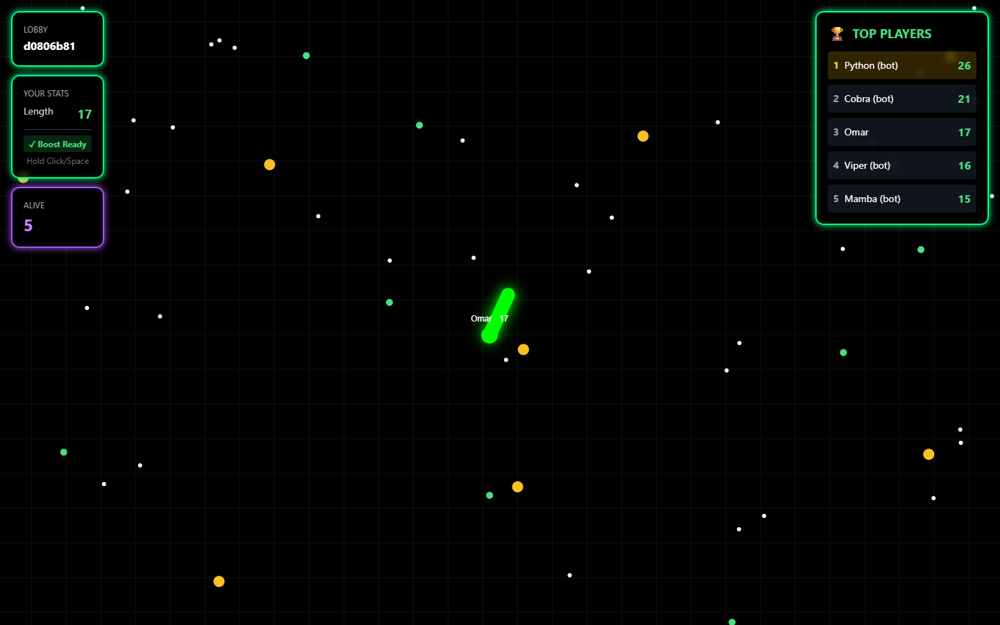

# multiplayer-snake-arena

A real-time multiplayer snake game. A Node.js server runs the simulation at 30 ticks per second and is the only source of truth; browsers send a steering angle and a boost flag and draw whatever state the server broadcasts. Lobbies that don't fill up with people get topped up with bots, so you can play alone.



## How it works

**Server** (`server/`, Express + Socket.IO)

- `LobbyManager` keeps one open lobby per mode (5 or 10 players). A human joining starts a bot-fill timer (`BOT_FILL_SECONDS`, default 10). When the lobby is full, or the timer runs out and bots take the empty seats, a 3-second countdown starts the round.
- `GameInstance` owns the round: it spawns snakes on a circle facing the centre, applies inputs, moves snakes, resolves collisions, turns dead snakes into pellets and ends the round when one snake is left (not during the first 5 seconds).
- `BotPlayer` steers bots: it backs away from nearby snake segments and walls, heads for pellets within 300 units, and boosts when chasing or fleeing. Each bot gets a random skill level that sets how often it reacts.
- Client input is checked before use (finite angle, boolean boost, only for your own snake), and nicknames are trimmed, stripped of control characters and capped at 20 characters.
- When the last human leaves a running round, the round is stopped and discarded.
- Finished matches go into an in-memory history (last 100 matches plus per-name totals for humans) served at `/api/leaderboard` and `/api/matches`. It resets when the server restarts.

**Shared rules** (`shared/physics.ts`): turning is capped per tick, boosting doubles speed once a snake is 15 long, hitting a wall or your own body kills you, hitting another snake's body kills you and credits that snake with the kill, and head-on collisions go to the longer snake.

**Client** (`app/`, Next.js 14 + Tailwind): a home page to pick a nickname and mode, a canvas game view with a camera that follows your snake, an in-game top-5 list, kill feed and results table, touch joystick controls, and a leaderboard page.

## Getting started

Requires Node.js 22 or newer. No database or external services are needed.

```bash
npm install
cp .env.example .env      # optional, the defaults work locally

npm run server            # game server on http://localhost:3001
npm run dev               # web app on http://localhost:3000, in a second terminal
```

Open http://localhost:3000, enter a nickname and pick a mode. If nobody else joins, bots fill the lobby after 10 seconds. Open a second browser window to play against yourself.

Controls: steer with the mouse, hold click or Space to boost.

## Configuration

| Variable | Used by | Default | Purpose |
| --- | --- | --- | --- |
| `PORT` | server | `3001` | Game server port |
| `APP_URL` | server | `http://localhost:3000` | Origin allowed by CORS |
| `BOT_FILL_SECONDS` | server | `10` | Wait before bots fill empty seats |
| `NEXT_PUBLIC_SOCKET_URL` | web app | `http://localhost:3001` | Where the browser connects |

## Socket events

| Direction | Event | Payload |
| --- | --- | --- |
| client → server | `join` | `{ mode: 'SMALL' \| 'LARGE', nickname }` |
| client → server | `player_input` | `{ angle, boosting }` |
| server → client | `joined`, `lobby_update`, `game_start` | lobby snapshot (players, count, required) |
| server → client | `game_state` | snakes and pellets, 30 times a second |
| server → client | `player_killed` | `{ killer, victim }` names |
| server → client | `game_end` | winner and per-player length, kills, survival time |
| server → client | `join_error` | `{ message }` |

## Scripts

```bash
npm test            # node:test suites for physics, lobbies and match history
npm run typecheck   # tsc --noEmit
npm run build       # production build of the web app
npm run server:prod # game server without file watching
```

## License

MIT
